# ForgeBench

[](https://github.com/seyhunak/forgebench/actions/workflows/tests.yml)
[](https://www.python.org/downloads/)
[](https://github.com/seyhunak/forgebench/releases)
[](LICENSE)
[](https://github.com/astral-sh/ruff)
[](https://docs.pytest.org/)
[](CODE_OF_CONDUCT.md)
[](https://github.com/seyhunak/forgebench/stargazers)
[](https://github.com/seyhunak/forgebench/issues)
[](https://github.com/seyhunak/forgebench/commits/main)

**Measure domain adaptation, not just model intelligence.**

ForgeBench is a reproducible, provider-agnostic benchmark harness for answering one question: did customizing a model — a better prompt, few-shot examples, structured output, a fine-tune — actually improve performance on a specific domain task, or did it just make the pipeline more complicated?

The first benchmark domain is **financial and transaction operations**: synthetic banking, accounting, claims, and e-commerce scenarios (transaction exception classification and reconciliation triage). No private data, no GPU, no API key required to run the pipeline.

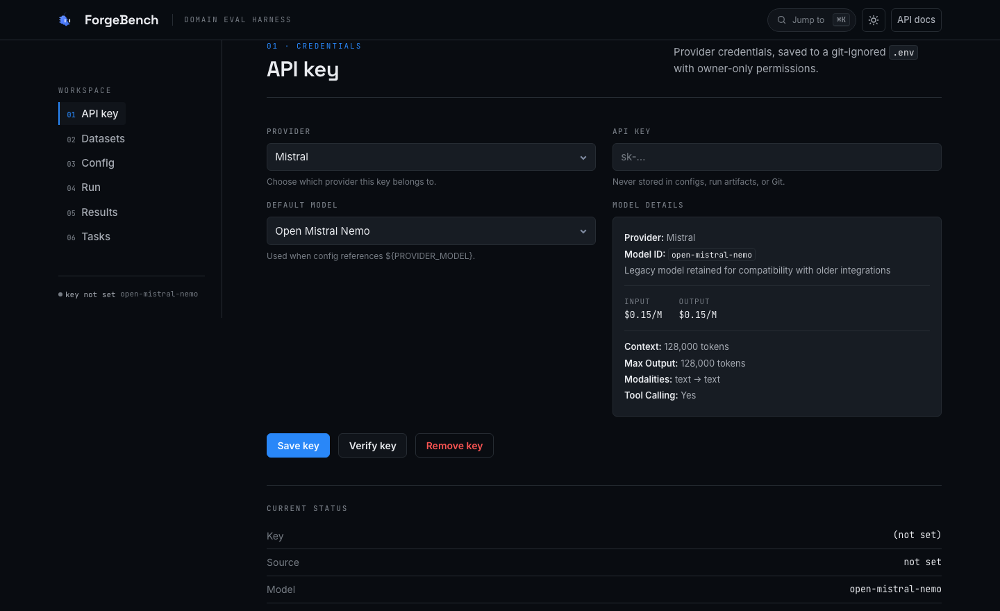

## ✨ Key Features

| Feature | Description |
|---------|-------------|
| **Fixed, versioned synthetic test sets** | Deterministic ground truth generated by rules, never by a model. Every split has a SHA-256 recorded in the manifest. |
| **Pluggable provider interface** | Mistral, OpenAI, Anthropic, Google, OpenRouter and Ollama adapters share one contract, plus a deterministic rule engine used only by the offline unit tests. OpenRouter — one key, every hosted model — is the default in the dashboard and CLI. |
| **Strict output validation** | A plausible explanation is not a correct answer. Unknown categories, malformed JSON, and invalid evidence fields are rejected. |
| **Risk-aware metrics** | Critical false-match rate and escalation recall are tracked separately — accuracy alone hides the expensive errors. |
| **Full run manifests** | Dataset hash, config, model id, versions, timestamps, git SHA, and environment are captured for every run — including the prompt that actually ran (`name@version`, SHA-256, provider default vs. registry vs. inline). |
| **Regression view** | Pin a run per dataset as its baseline, then open any later run and choose **Vs baseline**: metric deltas plus the exact cases that improved or regressed — the number that moves and the cases that moved it. |
| **Per-case trace waterfall** | Every run writes `trace.jsonl`: wall-clock spans per case (provider call with token counts, parse & score, judge). The run modal's *View trace* tab renders it, so "which step cost the time" is an answer, not a guess. |
| **Versioned prompt registry** | Prompts live in `prompts/<name>/vN.md` with immutable versions and labels (`production`). Pin one from a config with `prompt: {name: …, version: …}` or from the dashboard, and the run records the exact bytes it used. |
| **Machine-readable + human-readable results** | `predictions.jsonl`, `metrics.json`, `manifest.json`, `trace.jsonl`, and `report.md` per run. |
| **Bring-your-own-key (BYOK)** | API keys saved to a git-ignored `.env` (chmod 600), verified against the provider API, never committed, never in run artifacts. |
| **Local dashboard** | FastAPI-served, Hallmark-designed UI with a dark-first Cobalt theme, side-rail navigation, and a ⌘K jump palette — environment setup with per-provider key entry, key management, dataset browsing, run launching, and results browsing where every run opens a detail modal (report, predictions, downloadable artifacts) plus cross-run comparison. |
| **Deterministic dataset generator** | Same seed, byte-identical files. Regenerate `finance_v1` or add new datasets with `scripts/generate_dataset.py`. |
| **User-defined tasks** | Define any evaluation task in YAML — input fields, output schema, weighted scoring rules — and run it with `forgebench task-run`. No code required. |

## 🚀 Quickstart

Requires Python 3.11+.

```bash
git clone https://github.com/seyhunak/forgebench
cd forgebench
python -m venv .venv && source .venv/bin/activate
pip install -e ".[dev]"
```

### End-to-end pipeline

```bash
# 1. Validate the synthetic dataset
forgebench validate-dataset finance_v1

# 2. Save a key (OpenRouter by default), or use a local Ollama daemon
forgebench set-key --provider openrouter

# 3. Run the baseline and a prompt variant
forgebench run --config configs/baseline.yaml --run-id baseline
forgebench run --config configs/experiments/prompt_v1.yaml --run-id prompt-v1

# 4. Compare the two runs
forgebench compare runs/baseline runs/prompt-v1
```

Each run writes `predictions.jsonl`, `metrics.json`, `manifest.json`, `trace.jsonl`, and `report.md` under `runs/<run-id>/`.

Without a key, use a local model instead: `forgebench run --config configs/baseline.yaml --provider ollama --model <your-pulled-model>`.

### Running against real models (bring your own key)

```bash
# Save a key interactively (hidden prompt, verified against the provider API).
# OpenRouter is the default provider — pass --provider for another.
forgebench set-key --provider openrouter
forgebench set-key --provider mistral
forgebench set-key --provider openai
forgebench set-key --provider anthropic
forgebench set-key --provider google
forgebench set-key --provider ollama      # local/cloud Ollama — key optional

# Save a default model id with the key
forgebench set-key --model ministral-8b-2512 --provider mistral
forgebench set-key --model gpt-4o --provider openai
forgebench set-key --model claude-3-5-sonnet --provider anthropic
forgebench set-key --model gemini-2.5-pro --provider google
forgebench set-key --model anthropic/claude-3.5-sonnet --provider openrouter

# Check masked status
forgebench set-key --show

# Browse the catalog (OpenRouter alone has hundreds of models)
forgebench models --provider openrouter --search claude
forgebench models --provider openrouter --live   # straight from openrouter.ai

# Run with a real provider
forgebench run --config configs/mistral_baseline.yaml --provider mistral --run-id mistral-baseline
forgebench run --config configs/baseline.yaml --provider openai --model gpt-4o --run-id openai-baseline
forgebench run --config configs/baseline.yaml --provider openrouter --model google/gemini-2.5-pro --run-id openrouter-run
```

An exported `MISTRAL_API_KEY`, `OPENAI_API_KEY`, `ANTHROPIC_API_KEY`, `GOOGLE_API_KEY`, or `OPENROUTER_API_KEY` in your shell takes precedence over `.env`. Config references like `${MISTRAL_MODEL}` resolve from either.

### Local dashboard (optional UI)

```bash
pip install -e ".[ui]"
forgebench dashboard   # http://127.0.0.1:8502
```

The dashboard is a single-page app served by FastAPI. Navigate with the left rail, or press <kbd>⌘K</kbd> / <kbd>Ctrl K</kbd> to jump straight to any view:

- **01 Setup** — the first stop: a BYOK checklist of providers — **OpenRouter, Google, Anthropic, OpenAI, Ollama** (local, key optional), **Mistral** — one row each for its `*_API_KEY` (and default `*_MODEL`), with masked set/not-set status and source. Fill in the keys you use and save — everything is written to the git-ignored `.env` (chmod 600), never committed. Any other environment variable can be added below the provider list.
- **02 API key** — provider selector (Mock is gone from this list — it needs no key, and runs that name it are upgraded to the selected provider — and **Ollama** is listed with an install/running check: pick it and the view reports whether the daemon is up and fills the model dropdown with your locally pulled models). OpenRouter leads (the default: one key, every hosted model). Picking a provider fills the model dropdown with its full catalog from [models.dev](https://models.dev) and preselects a sensible model for it (e.g. `openai/gpt-4o-mini` for OpenRouter), so a first run works without hunting for an id. Save, verify, or remove a key, with live masked status and cost/context details. (The screenshot shows Mistral and its default `open-mistral-nemo` — that is the key saved in the demo environment.)
- **03 Datasets** — browse datasets and splits, inspect case tables, download JSON.
- **04 Config** — edit experiment YAML, validated before saving.
- **05 Run** — pick a config, optional case limit, live progress bar, run id.
- **06 Results** — run cards that open a detail modal: metrics, the full Markdown report, a predictions table, and Markdown/JSON downloads. Plus N-way comparison with colour-coded deltas.
- **07 Tasks** — validate and run user-defined evaluation tasks; provider defaults to OpenRouter with a model prefilled.

It ships a dark-first **Cobalt** theme with a light mode (toggle, top-right), and calls the exact same runner and reporting code as the CLI — so artifacts are identical.

| Results — run cards | Compare runs — deltas |
|:--:|:--:|
| 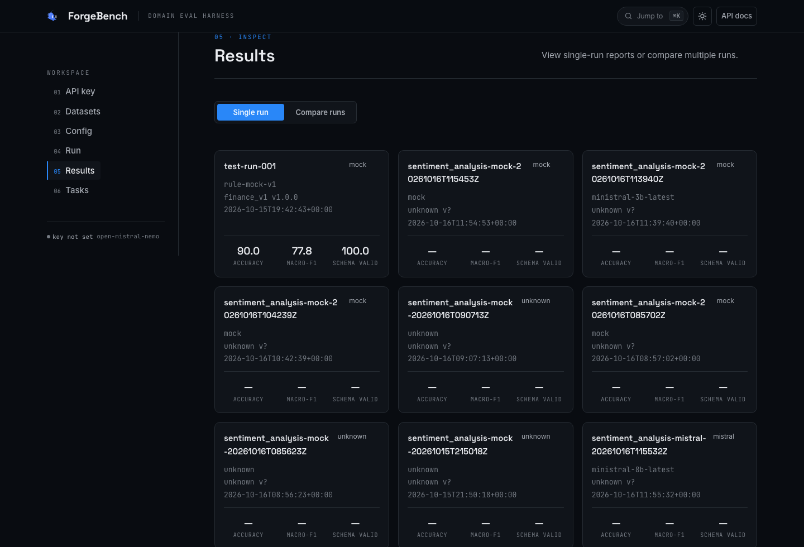 | 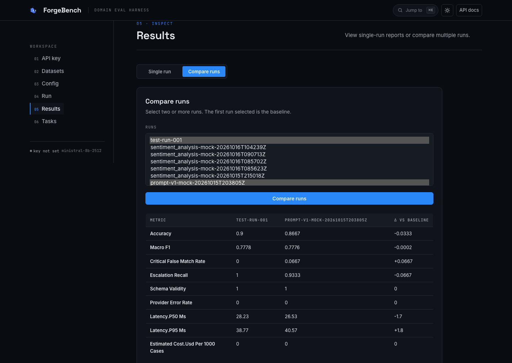 |
| **Run detail — modal report** | **Run detail — predictions** |
| 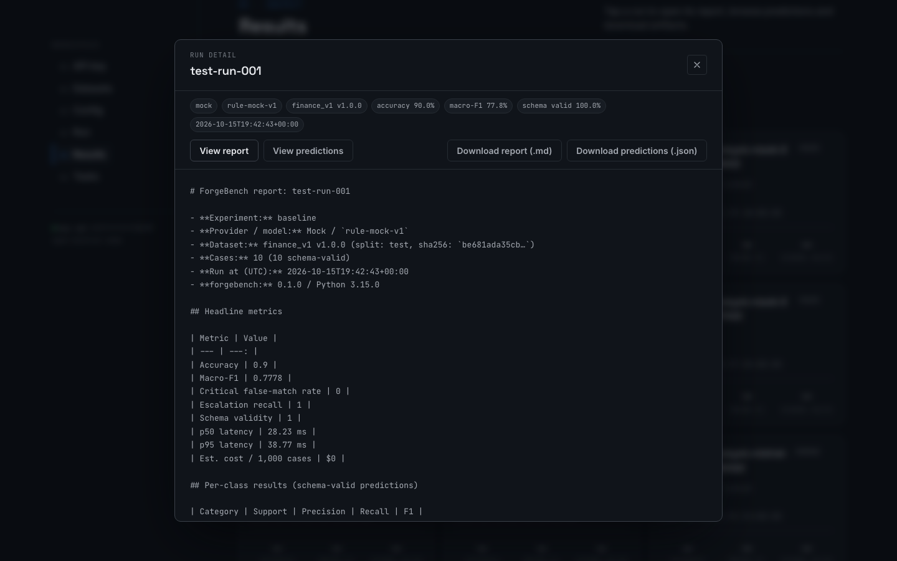 | 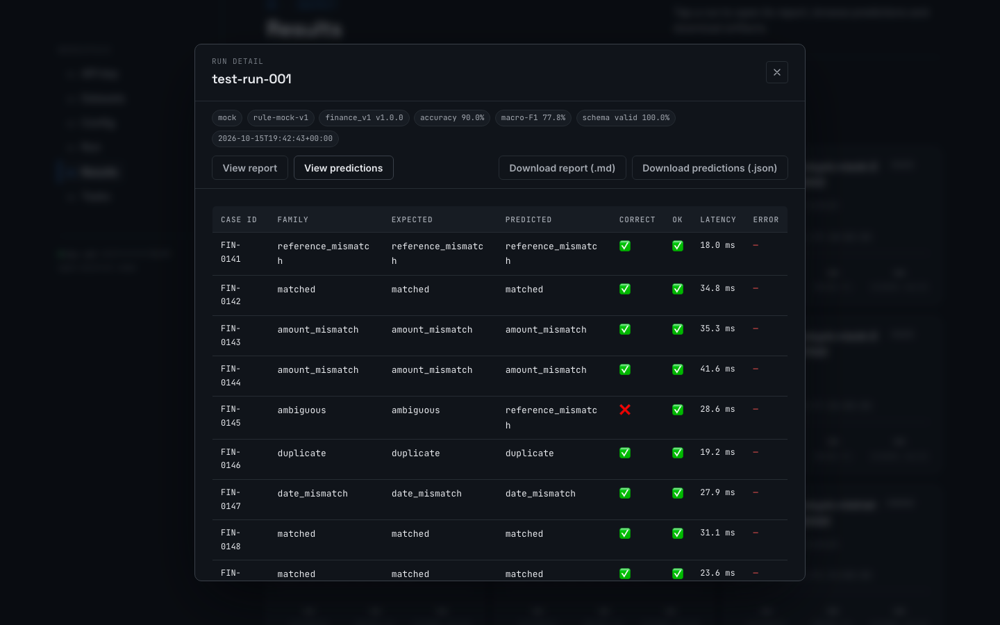 |
| **Datasets** | **Custom tasks** |
| 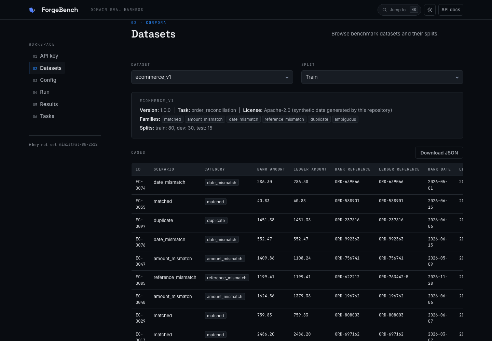 | 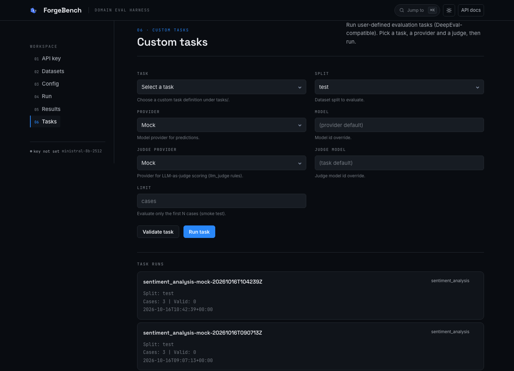 |
| **Setup — provider keys** | **Setup — narrow layout** |
| 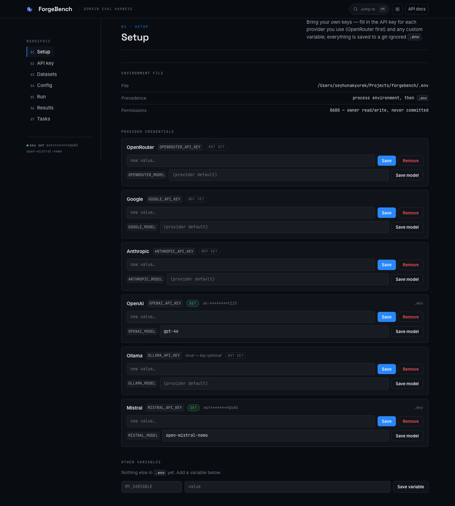 | 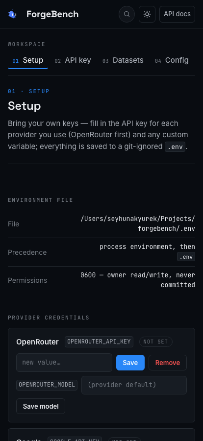 |
| **API key — Ollama install check** | **Ollama — narrow layout** |
| 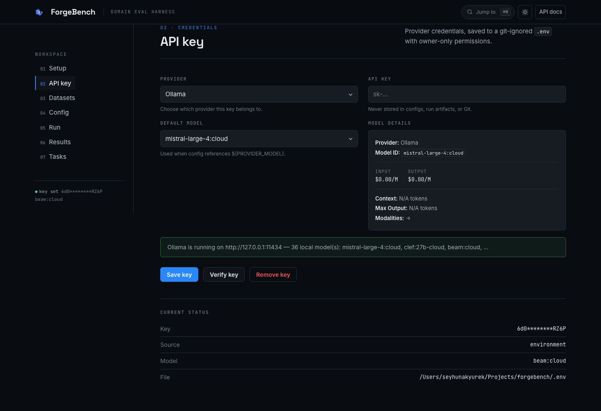 | 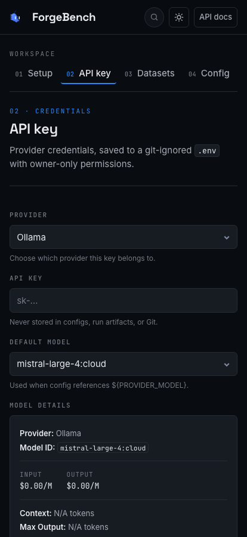 |
| **Light theme** | **Narrow layout** |
| 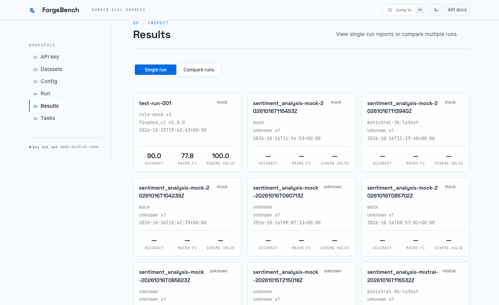 | 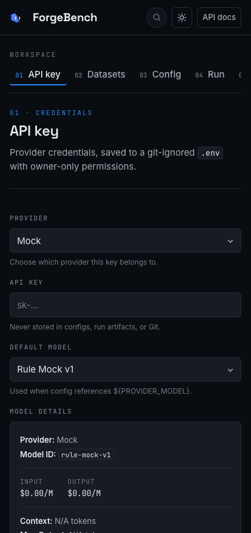 |

## 📋 CLI Reference

| Command | What it does |
|---------|-------------|
| `forgebench version` | Print the installed version |
| `forgebench set-key [--provider mistral\|openai\|anthropic\|google\|openrouter] [--model MODEL] [--show\|--clear\|--verify/--no-verify]` | Save an API key to git-ignored `.env` (chmod 600), optionally verify against the provider API. Default provider: `openrouter` |
| `forgebench models [--provider <p>] [--live] [--search <text>] [--limit N]` | List a provider's models (OpenRouter's full catalog; `--live` fetches from openrouter.ai) |
| `forgebench list-datasets` | List available datasets |
| `forgebench validate-dataset <name>` | Validate a dataset (schema, ids, splits, families, class distribution) |
| `forgebench task-list [--tasks-root <path>]` | List user-defined evaluation tasks under `tasks/` |
| `forgebench task-validate <name> [--tasks-root <path>]` | Validate a task manifest and its case files |
| `forgebench task-run <name> [--split <s>] [--provider <p>] [--model <id>] [--limit N] [--judge-provider <p>] [--judge-model <id>]` | Run a custom task evaluation end-to-end. Default provider: `openrouter` |
| `forgebench run --config <yaml> [--provider <name>] [--model <id>] [--limit N] [--run-id <id>] [--datasets-root <path>] [--output-root <path>]` | Execute one benchmark end-to-end |
| `forgebench prompt-list [--prompts-root <path>]` | List versioned prompts in the registry (`prompts/`) |
| `forgebench prompt-show <name> [--version N] [--prompts-root <path>]` | Print one prompt version (default: latest) |
| `forgebench prompt-save <name> [--file <path>] [--note <text>] [--label <text>] [--prompts-root <path>]` | Write the next immutable version of a prompt |
| `forgebench prompt-label <name> <label> <version> [--prompts-root <path>]` | Point a label (e.g. `production`) at a version; `0` removes the label |
| `forgebench compare <run-a> <run-b> [...] [--out <file>]` | N-way comparison with deltas vs. the first run (baseline) |
| `forgebench report <run-dir> [--out <file>]` | (Re)generate the Markdown report for a run |
| `forgebench dashboard` | Launch the local web UI |

## 🏗️ Providers

All providers implement the same `predict(case) -> ProviderResponse` contract:

| Provider | Adapter | Models | API key |
|----------|---------|--------|---------|
| **Mock** | `providers/mock.py` | `rule-mock-v1` | None — offline deterministic rule engine, used by unit tests only. Any run that names it is upgraded to the selected provider, and `task-run` rejects it. |
| **Mistral** | `providers/mistral.py` | `ministral-8b`, `ministral-3b`, `ministral-14b`, `mistral-small-4`, `mistral-large`, `mistral-medium` | `MISTRAL_API_KEY` |
| **OpenAI** | `providers/openai.py` | GPT-5, GPT-4.1, GPT-4o, o1, o3-mini families | `OPENAI_API_KEY` |
| **Anthropic** | `providers/anthropic.py` | Claude 4 Opus, Claude 4 Sonnet, Claude 3.5 Sonnet, Claude 3 Opus, Claude 3 Haiku | `ANTHROPIC_API_KEY` |
| **Google** | `providers/google.py` | Gemini 2.5 Pro, Gemini 2.5 Flash, Gemini 2.0 Flash, Gemini 1.5 Pro, Gemini 1.5 Flash | `GOOGLE_API_KEY` |
| **OpenRouter** | `providers/openrouter.py` | Every model OpenRouter hosts (hundreds), addressed as `vendor/model` — e.g. `anthropic/claude-3.5-sonnet`, `openai/gpt-4o`, `meta-llama/llama-3.1-70b-instruct`, `google/gemini-2.5-pro` | `OPENROUTER_API_KEY` |
| **Ollama** | `providers/ollama.py` (`OllamaProvider`) — local daemon | Whatever you have pulled — listed live from the daemon, not from a catalog | `OLLAMA_API_KEY` (optional for local Ollama) / `OLLAMA_HOST` |

The OpenRouter adapter speaks the REST API directly with the standard library, so it works on a bare install (no extra SDK). Its catalog is available from `forgebench models --provider openrouter` (the pinned snapshot) or `--live` (straight from `openrouter.ai/api/v1/models`).

**OpenRouter is the default provider.** The dashboard preselects it, and `forgebench set-key` / `forgebench task-run` use it unless `--provider` says otherwise. Config-driven `forgebench run` takes the provider from the config file (the bundled configs use OpenRouter), and an empty selection falls back to the first provider with a saved key — a run never silently degrades to the offline rule engine.

Model lists are synchronized from [models.dev](https://models.dev) and include pricing (input/output/cache read $/M tokens), context windows, and capabilities.

### Example: switching providers without changing config

```bash
# Same config, different provider
forgebench run --config configs/baseline.yaml --provider ollama --model llama3.1:8b --run-id ollama-run
forgebench run --config configs/baseline.yaml --provider mistral --run-id mistral-run
forgebench run --config configs/baseline.yaml --provider openai --model gpt-4o --run-id openai-run
forgebench run --config configs/baseline.yaml --provider anthropic --model claude-3-5-sonnet --run-id anthropic-run
forgebench run --config configs/baseline.yaml --provider google --model gemini-2.5-pro --run-id google-run
forgebench run --config configs/baseline.yaml --provider openrouter --model anthropic/claude-3.5-sonnet --run-id openrouter-run
```

## 📊 Datasets

| Dataset | Task | Cases | Splits | Version |
|---------|------|-------|--------|---------|
| `finance_v1` | Bank/ledger exception classification | 200 | 100 train / 40 dev / 60 test | 1.0.0 |
| `healthcare_v1` | Medical claims reconciliation | 125 | 80 train / 30 dev / 15 test | 1.0.0 |
| `ecommerce_v1` | Marketplace order vs ERP reconciliation | 125 | 80 train / 30 dev / 15 test | 1.0.0 |
| `legal_v1` | Contract clause reconciliation and exception triage | 105 | 42 train / 21 dev / 42 test | 1.0.0 |
| `insurance_v1` | Insurance claims adjudication and exception triage | 105 | 42 train / 21 dev / 42 test | 1.0.0 |
| `support_v1` | Customer support ticket triage and exception reconciliation | 105 | 42 train / 21 dev / 42 test | 1.0.0 |
| `payments_v1` | Payment settlement reconciliation and fraud/exception triage | 105 | 42 train / 21 dev / 42 test | 1.0.0 |
| `procurement_v1` | Purchase-order vs. supplier-invoice reconciliation | 105 | 42 train / 21 dev / 42 test | 1.0.0 |
| `subscriptions_v1` | SaaS subscription billing reconciliation | 105 | 42 train / 21 dev / 42 test | 1.0.0 |

All nine datasets reuse the same input field names as `finance_v1`, so they run through the existing pipeline with no code changes. Each has a matching config under `configs/` (for example `configs/legal_baseline.yaml`, `configs/payments_baseline.yaml`).

All datasets share six scenario families:

| Family | Meaning |
|--------|---------|
| `matched` | Amounts, dates, and references agree |
| `amount_mismatch` | Amounts differ (takes precedence when other fields also differ) |
| `date_mismatch` | Dates differ, amounts agree |
| `reference_mismatch` | References differ, amounts agree |
| `duplicate` | One side shows more occurrences than the other |
| `ambiguous` | Conflicting weak signals; human review required |

Dataset files live under `datasets/<name>/`:
- `dataset.json` — manifest (name, version, task, license, families, splits, SHA-256 hashes)
- `dataset_card.md` — human-readable documentation
- `train.jsonl`, `dev.jsonl`, `test.jsonl` — JSONL split files with ground-truth labels

View any dataset in the dashboard's **Datasets** view, or via the API:

```bash
curl http://localhost:8502/api/datasets
curl http://localhost:8502/api/datasets/healthcare_v1
curl http://localhost:8502/api/datasets/finance_v1/splits/test
```

Regenerate datasets deterministically:

```bash
# finance_v1 (and its variants)
python scripts/generate_dataset.py --seed 42 --train 100 --dev 40 --test 60

# legal_v1, insurance_v1, support_v1, payments_v1, procurement_v1, subscriptions_v1 (fixed seed 2026)
python scripts/generate_multi_dataset.py
```

## 📈 Metrics

| Metric | Definition | Why it matters |
|--------|------------|----------------|
| **Accuracy** | Correct / schema-valid classifications | Overall performance |
| **Macro-F1** | Mean F1 across classes with ground truth | Common classes can't dominate |
| **Critical false-match rate** | Truly non-matching cases wrongly called `matched` | The financially dangerous error — a false "matched" means money is assumed reconciled when it isn't |
| **Escalation recall** | Cases requiring review that were flagged for review | Missed exceptions that need human attention |
| **Schema validity** | Structured outputs passing the `Prediction` schema | Integration reliability — models that can't emit valid JSON are useless in pipelines |
| **Latency (p50/p95)** | Median and tail response time | Operational performance |
| **Estimated cost per 1,000 cases** | Provider pricing × tokens used | Budget comparison across providers/models |

Denominator conventions and evaluation rules are specified in [`docs/benchmark_protocol.md`](docs/benchmark_protocol.md).

### Regression view (run vs. baseline)

Pin one run per dataset as the baseline, then open any later run and choose
**Vs baseline** in the run modal:

```bash
# via the API (the dashboard's pin button posts exactly this)
curl -X POST localhost:8501/api/baselines \
  -H 'Content-Type: application/json' \
  -d '{"dataset": "finance_v1", "run_id": "runs/baseline-run-id"}'

curl localhost:8501/api/runs/new-run-id/regression
```

The comparison answers both questions a metric delta can't: which scalar
metrics moved, and *which cases flipped* (`improved` / `regressed` / still
correct / still wrong, plus cases added or dropped). Pins live in
`runs/baselines.json` — local state, never committed. The CLI equivalent is
`forgebench compare runs/baseline runs/new` for a Markdown report.

## ⚙️ Configuration

Experiments are YAML files under `configs/`. Example — `configs/baseline.yaml`:

```yaml
experiment:
  name: baseline
  dataset: finance_v1
  dataset_version: "1.0.0"
  split: test

provider:
  name: openrouter
  model: openai/gpt-4o-mini
  options:
    temperature: 0.0

inference:
  temperature: 0
  max_retries: 2
  timeout_seconds: 30
  max_tokens: 1024

prompt:
  name: reconciler      # optional: pull the system prompt from prompts/reconciler/
  version: null          # null/omitted = latest version
  system: null           # inline text; ignored when prompt.name is set
  few_shot_count: 0

evaluation:
  metrics:
    - accuracy
    - macro_f1
    - critical_false_match_rate
    - escalation_recall
    - schema_validity
    - latency
    - estimated_cost
```

Config values support `${ENV_VAR}` interpolation (e.g. `"${MISTRAL_MODEL}"`). Missing variables fail loudly — never silently.

The provider is optional in practice: an empty/missing selection falls back to
the first provider with a saved key, and the model falls back to the `*_MODEL`
value saved with `forgebench set-key`.

### Prompt registry

Prompts live as immutable files under `prompts/<name>/vN.md` with named labels:

```bash
forgebench prompt-list
forgebench prompt-save reconciler --file my_system_prompt.md --note "tighter rules" --label production
forgebench prompt-show reconciler --version 2
forgebench prompt-label reconciler production 3    # 0 removes the label
```

A config that sets `prompt: {name: reconciler}` runs whatever the registry
resolves (highest version unless `version:` pins one), and the run's manifest
records the prompt's SHA-256 plus the digest of the text the provider actually
sent — so two runs can be proven to have used the same instructions.

Configs can be edited in the dashboard's **Config** view, validated with Pydantic before saving.

## 📁 Repository Layout

```
forgebench/
├── README.md                    # This file
├── LICENSE                      # Apache-2.0
├── CODE_OF_CONDUCT.md           # Community covenant
├── CONTRIBUTING.md              # How to contribute
├── SECURITY.md                  # Security policy
├── Makefile                     # install, test, lint, data, demo, dashboard
├── pyproject.toml               # Project metadata, dependencies, scripts
├── .env.example                 # Environment variable template (git-ignored .env)
├── .gitignore                   # Python, secrets, run artifacts
├── configs/                     # Experiment YAML configs
│   ├── baseline.yaml            # OpenRouter reference baseline
│   ├── legal_baseline.yaml      # OpenRouter baselines for the legal, payments,
│   ├── payments_baseline.yaml   #   procurement and subscriptions datasets
│   ├── procurement_baseline.yaml
│   ├── subscriptions_baseline.yaml
│   ├── mistral_baseline.yaml    # Mistral baseline
│   └── experiments/
│       ├── prompt_v1.yaml       # Prompt variant
│       └── fewshot_v1.yaml      # Few-shot variant
├── prompts/                     # Versioned prompt registry (immutable vN.md + labels.json)
│   └── reconciler/              # Provider default system prompt, pinned as v1
├── datasets/                    # Versioned synthetic datasets
│   ├── finance_v1/              # Bank/ledger exception classification
│   ├── healthcare_v1/           # Medical claims reconciliation
│   ├── ecommerce_v1/            # Marketplace order vs ERP
│   ├── legal_v1/                # Contract clause reconciliation
│   ├── insurance_v1/            # Insurance claims adjudication
│   ├── support_v1/              # Support ticket triage
│   ├── payments_v1/             # Payment settlement / fraud triage
│   ├── procurement_v1/          # Purchase order vs supplier invoice
│   └── subscriptions_v1/        # SaaS subscription billing
├── tasks/                       # User-defined evaluation tasks (task.yaml + JSONL)
│   ├── sentiment_analysis/      # Classification with confidence and key phrases
│   ├── summarization_qa/        # Summary accuracy and hallucination checks
│   ├── code_review/             # Bug/security/style review with severity
│   ├── intent_classification/   # Support intent, confidence and entities
│   ├── named_entity_extraction/ # Typed entity extraction from free text
│   └── contract_clause_detection/ # Clause type, risk level, counsel flag
├── docs/                        # Architecture, protocol, integration notes, dashboard screenshots
├── scripts/                     # Deterministic dataset generators
│   ├── generate_dataset.py      # Regenerate finance_v1
│   └── generate_multi_dataset.py # Generate the six 105-case datasets
├── src/forgebench/              # Source code
│   ├── __init__.py              # Package, version
│   ├── cli.py                   # Typer CLI
│   ├── config.py                # Pydantic experiment config
│   ├── runner.py                # Load → validate → infer → score → record
│   ├── task_runner.py           # Custom task evaluation loop
│   ├── tasks.py                 # Task registry (locate, load, hash, validate)
│   ├── registry.py              # Dataset registry (locate, load, hash, validate)
│   ├── schemas.py               # BenchmarkCase, Prediction, Category, TaskDefinition enums
│   ├── credentials.py           # BYOK storage (.env, chmod 600)
│   ├── judge.py                 # G-Eval style LLM-as-judge scoring
│   ├── evidence.py              # Evidence field validation
│   ├── parsing.py               # Structured output parsing
│   ├── providers/               # Provider adapters
│   │   ├── __init__.py
│   │   ├── base.py              # ModelProvider protocol
│   │   ├── mock.py              # Deterministic rule engine
│   │   ├── mistral.py           # Mistral API adapter
│   │   ├── openai.py            # OpenAI API adapter
│   │   ├── anthropic.py         # Anthropic API adapter
│   │   ├── google.py            # Google API adapter
│   │   ├── openrouter.py        # OpenRouter adapter (OpenAI-compatible, stdlib HTTP)
│   │   └── verify.py            # Shared provider API-key verification
│   ├── metrics/                 # Metric computation (classification, performance, pricing, reliability, rag)
│   ├── reporting/               # Markdown + JSON report renderers
│   ├── api.py                   # FastAPI backend for the dashboard
│   ├── dashboard.py             # Legacy Streamlit entry point (kept for compat)
│   └── static/                  # Dashboard frontend (index.html, style.css, app.js, shell.js, models.json)
├── tests/                       # Unit + end-to-end tests (no API key needed)
└── runs/                        # Local run artifacts (git-ignored by default)
```

## 🧪 Testing

```bash
pip install -e ".[dev]"
pytest
```

The suite runs offline: tests that exercise the run pipeline inject a deterministic fake at the provider seam, so nothing spends API credits or flakes on the network. One smoke test hits a real provider and skips unless `OPENROUTER_API_KEY` is set.

## 🤝 Contributing

See [CONTRIBUTING.md](CONTRIBUTING.md). Good first contributions:

- Additional provider adapters (Cohere, Cohere Command, xAI Grok, etc.)
- Synthetic datasets for new domains (legal, insurance, supply chain)
- New metrics
- Independently reproduced runs with published `report.md` outputs
- Dashboard improvements (light/dark theme refinements, export formats)

All contributions follow the [Contributor Covenant](CODE_OF_CONDUCT.md).

## 🔒 Security

API keys are never stored in the repository. See [SECURITY.md](SECURITY.md) for the full policy, including how keys are stored (git-ignored `.env`, chmod 600), verified against provider APIs, and excluded from run artifacts.

---

## DeepEval-compatible evaluation features

ForgeBench adopts the best ideas from [DeepEval](https://github.com/confident-ai/deepeval) for LLM evaluation:

### LLM-as-judge (G-Eval style)
Subjective scoring criteria evaluated by any configured provider (Mistral, OpenAI, Anthropic, Google, OpenRouter, Ollama). Define criteria and chain-of-thought evaluation steps per scoring rule:

```yaml
scoring_rules:
  - field: summary_quality
    method: llm_judge
    weight: 2.0
    threshold: 0.7
    criteria: "Determine whether the summary captures all key facts without hallucination."
    evaluation_steps:
      - "Compare the summary against the source document."
      - "Penalize any claim not supported by the source."
      - "Score highly when meaning and key details match."
judge:
  provider: openai
  model: gpt-4o-mini
```

### RAG metrics (DeepEval RAGAS style)
Deterministic lexical metrics for retrieval-augmented generation, no LLM calls needed:

- `faithfulness` — share of the answer grounded in retrieved context
- `answer_relevancy` — vocab overlap between answer and question
- `contextual_relevancy` — share of retrieved chunks relevant to the question

```yaml
scoring_rules:
  - field: answer
    method: faithfulness
    threshold: 0.8
  - field: answer
    method: answer_relevancy
    threshold: 0.5
```

Set `retrieval_context` on each test case (in the JSONL `expected` block or case input) to enable context-aware scoring.

### Custom task builder
Define arbitrary evaluation tasks in YAML without code — input fields, output schema (string/number/boolean/enum/list[string]), scoring rules with weights and thresholds, plus G-Eval criteria:

```bash
forgebench task-list
forgebench task-validate sentiment_analysis
forgebench task-run sentiment_analysis --split test --provider openrouter --judge-provider openai --judge-model gpt-4o-mini
```

Six tasks ship with the repo under `tasks/`:

| Task | What it evaluates | Scoring methods |
|------|-------------------|-----------------|
| `sentiment_analysis` | Feedback sentiment with confidence and key phrases | exact_match, contains, f1 |
| `summarization_qa` | Summary accuracy, completeness, hallucination list | boolean, exact_match, f1 |
| `code_review` | Bug/security/style review with severity and fix flag | exact_match, boolean, contains |
| `intent_classification` | Support intent with confidence and extracted entities | exact_match, contains, f1 |
| `named_entity_extraction` | Typed entities from free text with count and primary type | f1, exact_match |
| `contract_clause_detection` | Clause type, risk level and counsel flag from contract text | exact_match, boolean |

Each task lives under `tasks/<name>/` with a `task.yaml` manifest and `train.jsonl`, `dev.jsonl`, `test.jsonl` case files.

### Safety / red-team scan (coming)
DeepEval's `deepteam` red-team workflow (vulnerability detection via adversarial attacks: prompt injection, jailbreaking, PII leakage, bias, toxicity) is planned as a `forgebench safety-scan` command.

## 📜 License

Code: [Apache-2.0](LICENSE). Model weights and third-party datasets carry their own terms — check each model card and license independently. Synthetic data in `datasets/` is generated by this repository and is also Apache-2.0.

---

*ForgeBench — measure domain adaptation, not just model intelligence.*

